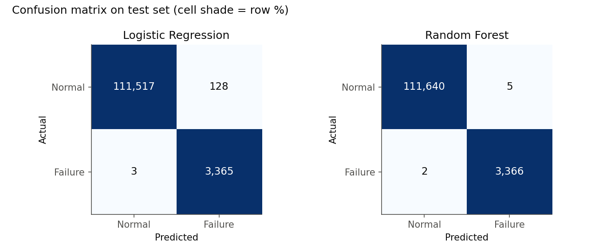
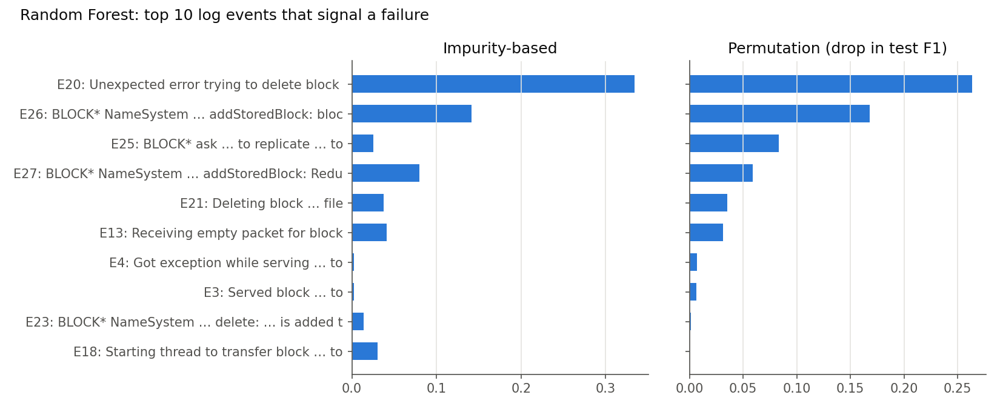
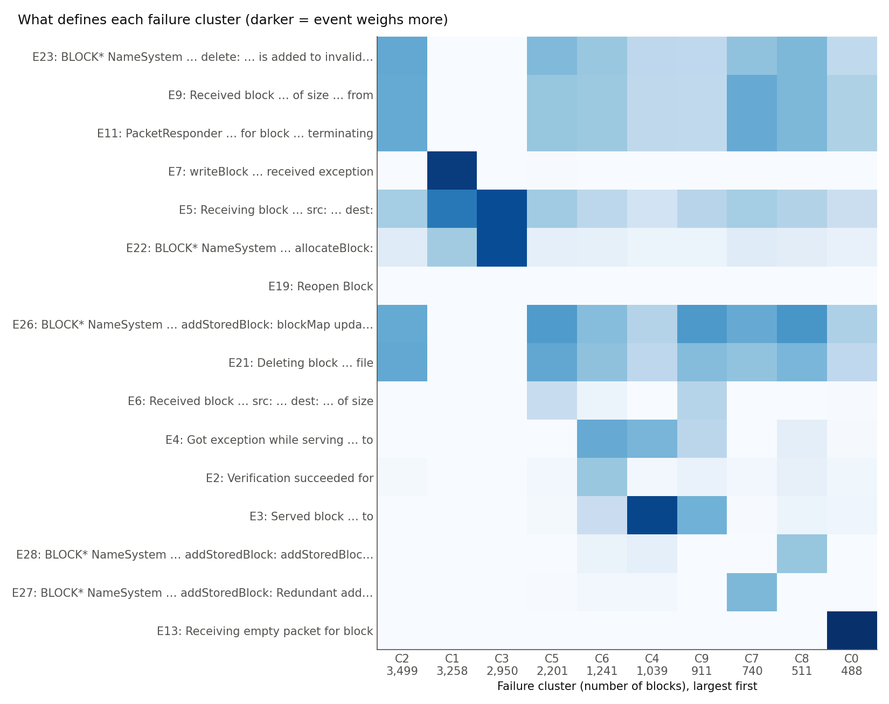
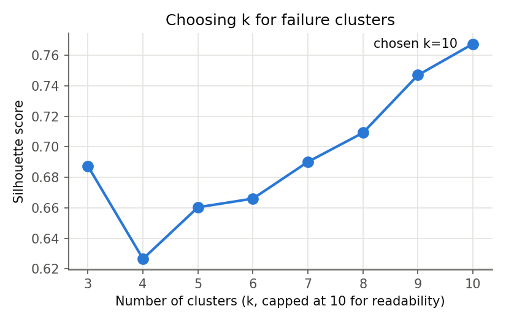

# LogTriage: ML failure detection and triage for system logs

An end-to-end pipeline that takes per-session log event counts, **detects failed sessions**, **groups failures
into categories** without labels, and **auto-generates a triage report** with real example log lines.

Built on the public [Loghub HDFS_v1](https://github.com/logpai/loghub) dataset: 11M+ log lines from a
Hadoop cluster, sliced into 575,061 sessions (one per storage block), each labeled normal or anomaly.
The same workflow applies to test-log triage: sessions become test runs and labels become pass/fail.

## Results

Held-out test set: 115,013 sessions, 3,368 failures (2.93%). The decision threshold is 0.5.

| Model | Precision | Recall | F1 | PR-AUC | Missed failures | False alarms |
|---|---|---|---|---|---|---|
| Logistic Regression (baseline) | 0.963 | 0.999 | 0.981 | 0.999 | 3 | 128 |
| **Random Forest (tuned)** | **0.999** | **0.999** | **0.999** | **1.000** | **2** | **5** |

- **The Random Forest cuts false alarms from 128 to 5** at the same recall. For triage, that means far fewer
  non-issues for an engineer to chase.
- **Failure categories:** the 16,838 failed sessions group into 10 categories. These agree with the dataset's
  reference failure-type codes (ARI 0.77, NMI 0.79) even though the codes were never used. 7 of the 10
  categories are 96–100% pure.
- **Top failure signals:** `Unexpected error trying to delete block … BlockInfo not found`,
  `addStoredBlock: blockMap updated` (missing or abnormal), `ask … to replicate`, and
  `Redundant addStoredBlock request`. Impurity-based and permutation importance agree on these.

### Why the scores are so high
The 575K sessions contain only **589 distinct event-count patterns**, and **99.96% of test sessions have an exact
copy in the training set**. Most of the test score therefore measures recognition of patterns already seen.
On the **45 test sessions whose pattern never appears in training** (34 failures), the Random Forest scores
**F1 0.955** (Logistic Regression: 0.941). That subset is small, so treat the number as indicative.

| | |
|---|---|
|  |  |
|  |  |

A full generated example is in [reports/triage_report.md](reports/triage_report.md).

## Pipeline

```
Event_occurrence_matrix.csv ─► data.py ─► split.py ─► train.py ─► evaluate.py ─► cluster.py ─► report.py
  (29 event counts / session)   checks    80/20       LogReg +     test metrics    KMeans on     triage_report.md
                                          stratified  tuned RF     + importance    failures      + raw log examples
```

| Step | File | What it does |
|---|---|---|
| Load | `src/data.py` | Loads the event-count matrix and labels; checks rows, missing values, duplicates, label agreement and class balance. Keeps the `Type` code out of the features (it is only set for failures, so it would leak the answer). |
| Split | `src/split.py` | Stratified 80/20 split with seed 42; indices saved to `splits.npz`. |
| Train | `src/train.py` | Baseline: log1p, StandardScaler, then LogisticRegression. Main model: RandomForest tuned with `RandomizedSearchCV` (3-fold stratified CV, F1, training set only). Both use `class_weight="balanced"`. |
| Evaluate | `src/evaluate.py` | Precision, recall, F1, PR-AUC, confusion matrices, PR curves, impurity and permutation importance, and the train/test overlap check. |
| Cluster | `src/cluster.py` | TF-IDF on the failed sessions' event counts, then KMeans. Picks k by silhouette, names clusters by their most over-represented events, and scores agreement with the Type codes (ARI/NMI). |
| Report | `src/report.py` | Builds a Markdown triage report: summary, metrics, categories, and example raw log lines from `HDFS.log`, with the category's defining event shown first. |

## How to run

```bash
python3 -m venv .venv && source .venv/bin/activate
pip install -r requirements.txt
```

Download `HDFS_v1` from [Loghub](https://github.com/logpai/loghub) and place it at `data/HDFS_v1/`
(it should contain `HDFS.log` and `preprocessed/`). Then run:

```bash
python src/data.py       # sanity checks
python src/split.py      # train/test split
python src/train.py      # ~1 min
python src/evaluate.py
python src/cluster.py
python src/report.py     # ~15 s (scans HDFS.log for examples)
```

Outputs go to `reports/` (metrics JSON, plots, cluster assignments, `triage_report.md`) and `models/`.

## Limitations

- **HDFS_v1 is a well-known, easy benchmark.** Near-perfect detection is expected; the overlap check above
  shows why. A tougher evaluation would split by distinct pattern (e.g. `GroupShuffleSplit`) so every test
  pattern is unseen.
- **Features are event counts only.** Event order (`Event_traces.csv`) and timing are not used yet. The 3 mixed
  clusters (C4, C5, C6) are where order would most likely help.
- **k = 10 is a readability cap.** Silhouette kept rising with k, so 10 is not a proven optimum.
- **Category names come from log templates**, not verified root causes.
- These are distributed-storage system logs, not cellular test logs. The pipeline transfers to other logs;
  the scores do not.
- Raw log parsing (e.g. Drain) is not reimplemented here; the pipeline starts from Loghub's preprocessed templates.

## Next steps

- Parse `HDFS.log` with Drain3 and validate the templates against Loghub's.
- Add sequence features or a small sequence model on `Event_traces.csv`.
- Add an unsupervised detector (IsolationForest) for the case with no labels.
- Add pytest tests and a GitHub Actions workflow that runs the pipeline on a small fixture.
- Publish the report automatically (HTML, email or SharePoint).

## Data and citation

Loghub HDFS_v1. Please cite:
- W. Xu, L. Huang, A. Fox, D. Patterson, M. Jordan. *Detecting Large-Scale System Problems by Mining Console Logs.* SOSP 2009.
- J. Zhu, S. He, P. He, J. Liu, M. R. Lyu. *Loghub: A Large Collection of System Log Datasets for AI-driven Log Analytics.* ISSRE 2023.

The dataset is not included in this repository; see Loghub for its terms of use.
