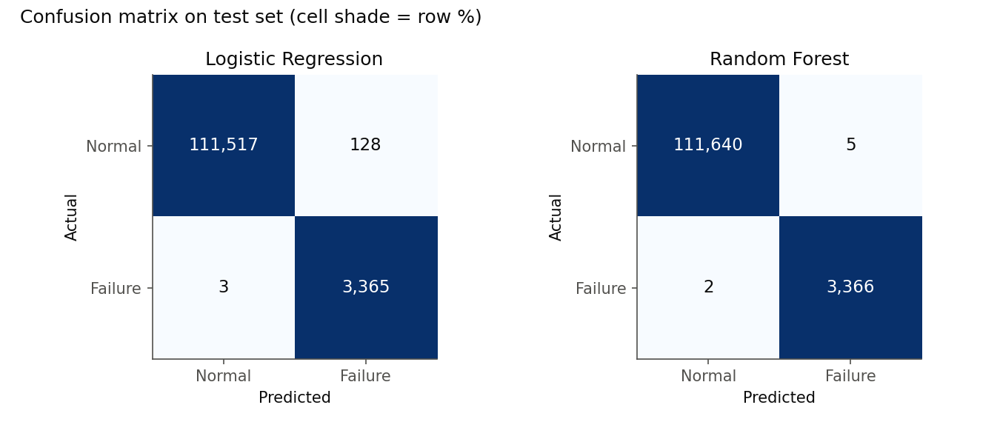
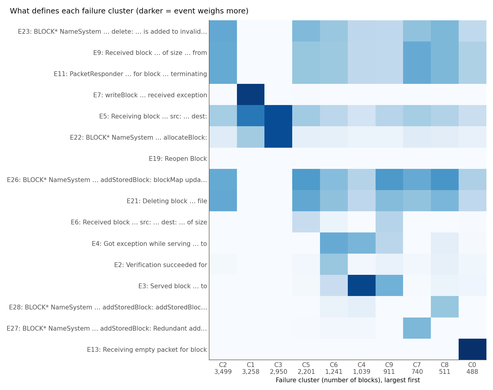
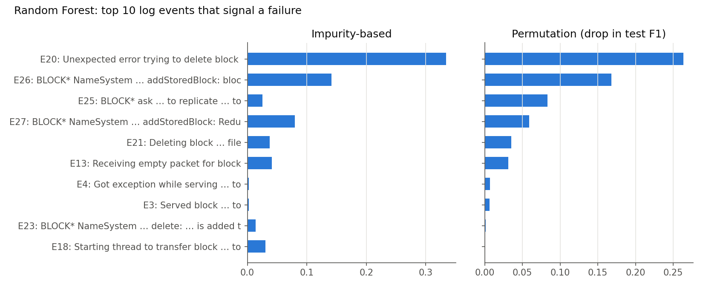

# LogTriage report: HDFS failure triage
_Generated 2026-11-11 01:23 by `src/report.py`. Dataset: Loghub HDFS_v1 (Xu et al., SOSP 2009; Zhu et al., ISSRE 2023)._

## Summary
- **115,013 test sessions** analysed, **3,368 failures (2.93%)**.
- The Random Forest caught **99.94%** of failures (missed 2) with **5 false alarms**, vs. 128 for the Logistic Regression baseline.
- 16,838 failed sessions grouped into **10 categories**. The three largest cover 57.6% of failures.
- The categories match the dataset's reference failure-type codes with ARI 0.77 / NMI 0.79, without using those codes.

## Failure detection
| Model | Precision | Recall | F1 | PR-AUC | Missed failures | False alarms | CV F1 (train) |
|---|---|---|---|---|---|---|---|
| Logistic Regression | 0.9634 | 0.9991 | 0.9809 | 0.9992 | 3 | 128 | 0.9790 |
| Random Forest | 0.9985 | 0.9994 | 0.9990 | 0.9997 | 2 | 5 | 0.9980 |

> **Caveat:** only 589 distinct event patterns exist, and 99.96% of test sessions have an exact copy in training. On the 45 test sessions with a pattern never seen in training (34 failures), Random Forest F1 is **0.955** (missed 2, 1 false alarm). That subset is small, so treat it as indicative.



## Failure categories
Each category is named after its most distinctive log event (auto-generated).

| # | Category (top event) | Sessions | Share | Purity vs. Type code |
|---|---|---|---|---|
| C2 | E23: `BLOCK* NameSystem … delete: … is added to invalidSet of` | 3,499 | 20.8% | 96% Type 5 |
| C1 | E7: `writeBlock … received exception` | 3,258 | 19.3% | 99% Type 31 |
| C3 | E22: `BLOCK* NameSystem … allocateBlock:` | 2,950 | 17.5% | 100% Type 3 |
| C5 | E26: `BLOCK* NameSystem … addStoredBlock: blockMap updated: …` | 2,201 | 13.1% | 72% Type 0 |
| C6 | E4: `Got exception while serving … to` | 1,241 | 7.4% | 45% Type 21 |
| C4 | E3: `Served block … to` | 1,039 | 6.2% | 45% Type 4 |
| C9 | E3: `Served block … to` | 911 | 5.4% | 96% Type 0 |
| C7 | E27: `BLOCK* NameSystem … addStoredBlock: Redundant addStore…` | 740 | 4.4% | 100% Type 1 |
| C8 | E28: `BLOCK* NameSystem … addStoredBlock: addStoredBlock req…` | 511 | 3.0% | 100% Type 4 |
| C0 | E13: `Receiving empty packet for block` | 488 | 2.9% | 98% Type 7 |



## Category details
### C2: 3,499 sessions (20.8%)
Defining events: **E23** `BLOCK* NameSystem … delete: … is added to invalidSet of`; **E9** `Received block … of size … from`; **E11** `PacketResponder … for block … terminating`

Example `blk_7407365935722115229` (20 lines; defining events shown first):
```
081110 220656 32 INFO dfs.FSNamesystem: BLOCK* NameSystem.delete: blk_7407365935722115229 is added to invalidSet of 10.250.10.6:50010
081110 220656 32 INFO dfs.FSNamesystem: BLOCK* NameSystem.delete: blk_7407365935722115229 is added to invalidSet of 10.251.26.8:50010
081110 220656 32 INFO dfs.FSNamesystem: BLOCK* NameSystem.delete: blk_7407365935722115229 is added to invalidSet of 10.251.30.6:50010
081110 215659 15383 INFO dfs.DataNode$PacketResponder: Received block blk_7407365935722115229 of size 67108864 from /10.251.30.6
```
Example `blk_9086825041638526343` (20 lines; defining events shown first):
```
081110 103130 30 INFO dfs.FSNamesystem: BLOCK* NameSystem.delete: blk_9086825041638526343 is added to invalidSet of 10.251.127.47:50010
081110 103130 30 INFO dfs.FSNamesystem: BLOCK* NameSystem.delete: blk_9086825041638526343 is added to invalidSet of 10.251.30.6:50010
081110 103130 30 INFO dfs.FSNamesystem: BLOCK* NameSystem.delete: blk_9086825041638526343 is added to invalidSet of 10.251.31.160:50010
081109 233200 3938 INFO dfs.DataNode$PacketResponder: Received block blk_9086825041638526343 of size 67108864 from /10.251.31.160
```

### C1: 3,258 sessions (19.3%)
Defining events: **E7** `writeBlock … received exception`; **E5** `Receiving block … src: … dest:`; **E22** `BLOCK* NameSystem … allocateBlock:`

Example `blk_6432711689151983459` (4 lines; defining events shown first):
```
081111 074926 23703 INFO dfs.DataNode$DataXceiver: writeBlock blk_6432711689151983459 received exception java.io.IOException: Could not read from stream
081111 074919 23703 INFO dfs.DataNode$DataXceiver: Receiving block blk_6432711689151983459 src: /10.251.194.129:60015 dest: /10.251.194.129:50010
081111 074924 23217 INFO dfs.DataNode$DataXceiver: Receiving block blk_6432711689151983459 src: /10.251.194.129:57319 dest: /10.251.194.129:50010
081111 074919 30 INFO dfs.FSNamesystem: BLOCK* NameSystem.allocateBlock: /user/root/rand6/_temporary/_task_200811101024_0013_m_001793_1/part-01793. blk_6432711689151983459
```
Example `blk_-4634439818408631748` (4 lines; defining events shown first):
```
081110 000049 4591 INFO dfs.DataNode$DataXceiver: writeBlock blk_-4634439818408631748 received exception java.io.IOException: Could not read from stream
081110 000047 4527 INFO dfs.DataNode$DataXceiver: Receiving block blk_-4634439818408631748 src: /10.250.6.223:36879 dest: /10.250.6.223:50010
081110 000047 4591 INFO dfs.DataNode$DataXceiver: Receiving block blk_-4634439818408631748 src: /10.250.6.223:42298 dest: /10.250.6.223:50010
081110 000047 26 INFO dfs.FSNamesystem: BLOCK* NameSystem.allocateBlock: /user/root/sortrand/_temporary/_task_200811092030_0002_r_000288_0/part-00288. blk_-4634439818408631748
```

### C3: 2,950 sessions (17.5%)
Defining events: **E22** `BLOCK* NameSystem … allocateBlock:`; **E5** `Receiving block … src: … dest:`; **E19** `Reopen Block`

Example `blk_3211379818880198801` (2 lines; defining events shown first):
```
081109 205343 29 INFO dfs.FSNamesystem: BLOCK* NameSystem.allocateBlock: /user/root/rand/_temporary/_task_200811092030_0001_m_000404_0/part-00404. blk_3211379818880198801
081109 205343 841 INFO dfs.DataNode$DataXceiver: Receiving block blk_3211379818880198801 src: /10.251.195.52:57967 dest: /10.251.195.52:50010
```
Example `blk_-6781787835848441277` (2 lines; defining events shown first):
```
081111 104701 28 INFO dfs.FSNamesystem: BLOCK* NameSystem.allocateBlock: /user/root/randtxt9/_temporary/_task_200811101024_0016_m_001373_0/part-01373. blk_-6781787835848441277
081111 104702 27162 INFO dfs.DataNode$DataXceiver: Receiving block blk_-6781787835848441277 src: /10.251.70.211:47151 dest: /10.251.70.211:50010
```

### C5: 2,201 sessions (13.1%)
Defining events: **E26** `BLOCK* NameSystem … addStoredBlock: blockMap updated: …`; **E21** `Deleting block … file`; **E6** `Received block … src: … dest: … of size`

Example `blk_6402839225524905951` (27 lines; defining events shown first):
```
081111 053439 30 INFO dfs.FSNamesystem: BLOCK* NameSystem.addStoredBlock: blockMap updated: 10.251.107.50:50010 is added to blk_6402839225524905951 size 67108864
081111 053440 31 INFO dfs.FSNamesystem: BLOCK* NameSystem.addStoredBlock: blockMap updated: 10.251.194.147:50010 is added to blk_6402839225524905951 size 67108864
081111 053440 34 INFO dfs.FSNamesystem: BLOCK* NameSystem.addStoredBlock: blockMap updated: 10.251.67.113:50010 is added to blk_6402839225524905951 size 67108864
081111 070541 27 INFO dfs.FSNamesystem: BLOCK* NameSystem.addStoredBlock: blockMap updated: 10.251.127.243:50010 is added to blk_6402839225524905951 size 67108864
```
Example `blk_311230975369278533` (27 lines; defining events shown first):
```
081110 210957 27 INFO dfs.FSNamesystem: BLOCK* NameSystem.addStoredBlock: blockMap updated: 10.251.194.102:50010 is added to blk_311230975369278533 size 67108864
081110 210957 34 INFO dfs.FSNamesystem: BLOCK* NameSystem.addStoredBlock: blockMap updated: 10.250.7.96:50010 is added to blk_311230975369278533 size 67108864
081110 211657 35 INFO dfs.FSNamesystem: BLOCK* NameSystem.addStoredBlock: blockMap updated: 10.250.11.194:50010 is added to blk_311230975369278533 size 67108864
081110 211942 32 INFO dfs.FSNamesystem: BLOCK* NameSystem.addStoredBlock: blockMap updated: 10.251.39.160:50010 is added to blk_311230975369278533 size 67108864
```

### C6: 1,241 sessions (7.4%)
Defining events: **E4** `Got exception while serving … to`; **E2** `Verification succeeded for`; **E21** `Deleting block … file`

Example `blk_-3922613636663916930` (30 lines; defining events shown first):
```
081110 124417 11400 WARN dfs.DataNode$DataXceiver: 10.251.215.70:50010:Got exception while serving blk_-3922613636663916930 to /10.251.66.102:
081110 124418 11576 WARN dfs.DataNode$DataXceiver: 10.251.75.49:50010:Got exception while serving blk_-3922613636663916930 to /10.251.31.242:
081110 112102 13 INFO dfs.DataBlockScanner: Verification succeeded for blk_-3922613636663916930
081110 104759 19 INFO dfs.FSDataset: Deleting block blk_-3922613636663916930 file /mnt/hadoop/dfs/data/current/blk_-3922613636663916930
```
Example `blk_7612362880760959356` (26 lines; defining events shown first):
```
081109 215149 2871 WARN dfs.DataNode$DataXceiver: 10.251.199.245:50010:Got exception while serving blk_7612362880760959356 to /10.251.31.180:
081109 215155 2877 WARN dfs.DataNode$DataXceiver: 10.251.199.245:50010:Got exception while serving blk_7612362880760959356 to /10.251.67.211:
081109 205834 13 INFO dfs.DataBlockScanner: Verification succeeded for blk_7612362880760959356
081110 042700 13 INFO dfs.DataBlockScanner: Verification succeeded for blk_7612362880760959356
```

### C4: 1,039 sessions (6.2%)
Defining events: **E3** `Served block … to`; **E4** `Got exception while serving … to`; **E28** `BLOCK* NameSystem … addStoredBlock: addStoredBlock req…`

Example `blk_8493889915483495891` (29 lines; defining events shown first):
```
081110 052136 7100 INFO dfs.DataNode$DataXceiver: 10.251.195.70:50010 Served block blk_8493889915483495891 to /10.251.195.70
081110 052450 6764 INFO dfs.DataNode$DataXceiver: 10.251.29.239:50010 Served block blk_8493889915483495891 to /10.251.66.3
081110 071914 7823 INFO dfs.DataNode$DataXceiver: 10.251.195.70:50010 Served block blk_8493889915483495891 to /10.251.66.3
081110 071919 7846 INFO dfs.DataNode$DataXceiver: 10.251.42.84:50010 Served block blk_8493889915483495891 to /10.251.42.84
```
Example `blk_4820488330444951861` (30 lines; defining events shown first):
```
081110 060044 7116 INFO dfs.DataNode$DataXceiver: 10.251.107.196:50010 Served block blk_4820488330444951861 to /10.251.107.196
081110 060227 6871 INFO dfs.DataNode$DataXceiver: 10.251.106.10:50010 Served block blk_4820488330444951861 to /10.251.106.10
081110 072352 7537 INFO dfs.DataNode$DataXceiver: 10.251.203.129:50010 Served block blk_4820488330444951861 to /10.251.203.129
081110 072423 7541 INFO dfs.DataNode$DataXceiver: 10.251.203.129:50010 Served block blk_4820488330444951861 to /10.251.126.83
```

### C9: 911 sessions (5.4%)
Defining events: **E3** `Served block … to`; **E26** `BLOCK* NameSystem … addStoredBlock: blockMap updated: …`; **E6** `Received block … src: … dest: … of size`

Example `blk_-7545383382877785669` (41 lines; defining events shown first):
```
081110 175058 13889 INFO dfs.DataNode$DataXceiver: 10.251.126.227:50010 Served block blk_-7545383382877785669 to /10.251.126.227
081110 175359 13892 INFO dfs.DataNode$DataXceiver: 10.251.126.227:50010 Served block blk_-7545383382877785669 to /10.251.42.16
081111 004736 17300 INFO dfs.DataNode$DataXceiver: 10.251.126.227:50010 Served block blk_-7545383382877785669 to /10.251.126.227
081111 005039 13396 INFO dfs.DataNode$DataXceiver: 10.251.39.160:50010 Served block blk_-7545383382877785669 to /10.251.42.16
```
Example `blk_8391112948168343871` (41 lines; defining events shown first):
```
081110 191215 13996 INFO dfs.DataNode$DataXceiver: 10.251.195.52:50010 Served block blk_8391112948168343871 to /10.250.6.4
081110 202454 14267 INFO dfs.DataNode$DataXceiver: 10.251.71.68:50010 Served block blk_8391112948168343871 to /10.251.214.175
081111 020829 13378 INFO dfs.DataNode$DataXceiver: 10.251.123.33:50010 Served block blk_8391112948168343871 to /10.251.107.98
081110 122450 26 INFO dfs.FSNamesystem: BLOCK* NameSystem.addStoredBlock: blockMap updated: 10.251.195.52:50010 is added to blk_8391112948168343871 size 67108864
```

### C7: 740 sessions (4.4%)
Defining events: **E27** `BLOCK* NameSystem … addStoredBlock: Redundant addStore…`; **E9** `Received block … of size … from`; **E11** `PacketResponder … for block … terminating`

Example `blk_6921749885804552642` (20 lines; defining events shown first):
```
081110 152352 27 WARN dfs.FSNamesystem: BLOCK* NameSystem.addStoredBlock: Redundant addStoredBlock request received for blk_6921749885804552642 on 10.251.90.81:50010 size 67108864
081110 152352 13101 INFO dfs.DataNode$PacketResponder: Received block blk_6921749885804552642 of size 67108864 from /10.251.26.177
081110 152352 13220 INFO dfs.DataNode$PacketResponder: Received block blk_6921749885804552642 of size 67108864 from /10.251.26.177
081110 152352 13532 INFO dfs.DataNode$PacketResponder: Received block blk_6921749885804552642 of size 67108864 from /10.251.67.113
```
Example `blk_-5388895105420006026` (20 lines; defining events shown first):
```
081110 151649 31 WARN dfs.FSNamesystem: BLOCK* NameSystem.addStoredBlock: Redundant addStoredBlock request received for blk_-5388895105420006026 on 10.251.43.115:50010 size 67108864
081110 151633 13132 INFO dfs.DataNode$PacketResponder: Received block blk_-5388895105420006026 of size 67108864 from /10.251.111.209
081110 151633 13253 INFO dfs.DataNode$PacketResponder: Received block blk_-5388895105420006026 of size 67108864 from /10.251.43.115
081110 151633 13366 INFO dfs.DataNode$PacketResponder: Received block blk_-5388895105420006026 of size 67108864 from /10.251.43.115
```

### C8: 511 sessions (3.0%)
Defining events: **E28** `BLOCK* NameSystem … addStoredBlock: addStoredBlock req…`; **E26** `BLOCK* NameSystem … addStoredBlock: blockMap updated: …`; **E9** `Received block … of size … from`

Example `blk_-3471591675366888738` (21 lines; defining events shown first):
```
081110 104629 27 INFO dfs.FSNamesystem: BLOCK* NameSystem.addStoredBlock: addStoredBlock request received for blk_-3471591675366888738 on 10.251.106.10:50010 size 67108864 But it does not belong to any file.
081109 235536 28 INFO dfs.FSNamesystem: BLOCK* NameSystem.addStoredBlock: blockMap updated: 10.251.126.255:50010 is added to blk_-3471591675366888738 size 67108864
081109 235536 34 INFO dfs.FSNamesystem: BLOCK* NameSystem.addStoredBlock: blockMap updated: 10.251.106.10:50010 is added to blk_-3471591675366888738 size 67108864
081109 235536 35 INFO dfs.FSNamesystem: BLOCK* NameSystem.addStoredBlock: blockMap updated: 10.251.38.197:50010 is added to blk_-3471591675366888738 size 67108864
```
Example `blk_1586164007556399766` (24 lines; defining events shown first):
```
081110 104629 27 INFO dfs.FSNamesystem: BLOCK* NameSystem.addStoredBlock: addStoredBlock request received for blk_1586164007556399766 on 10.251.106.10:50010 size 67108864 But it does not belong to any file.
081109 212913 26 INFO dfs.FSNamesystem: BLOCK* NameSystem.addStoredBlock: blockMap updated: 10.251.106.10:50010 is added to blk_1586164007556399766 size 67108864
081109 212913 28 INFO dfs.FSNamesystem: BLOCK* NameSystem.addStoredBlock: blockMap updated: 10.251.71.97:50010 is added to blk_1586164007556399766 size 67108864
081109 212913 34 INFO dfs.FSNamesystem: BLOCK* NameSystem.addStoredBlock: blockMap updated: 10.251.125.174:50010 is added to blk_1586164007556399766 size 67108864
```

### C0: 488 sessions (2.9%)
Defining events: **E13** `Receiving empty packet for block`; **E9** `Received block … of size … from`; **E11** `PacketResponder … for block … terminating`

Example `blk_3679778751499479168` (23 lines; defining events shown first):
```
081109 205857 1038 INFO dfs.DataNode$BlockReceiver: Receiving empty packet for block blk_3679778751499479168
081109 205857 1038 INFO dfs.DataNode$BlockReceiver: Receiving empty packet for block blk_3679778751499479168
081109 205857 1050 INFO dfs.DataNode$BlockReceiver: Receiving empty packet for block blk_3679778751499479168
081109 205857 1039 INFO dfs.DataNode$PacketResponder: Received block blk_3679778751499479168 of size 3538517 from /10.251.43.210
```
Example `blk_4486182646317337673` (23 lines; defining events shown first):
```
081111 045901 20225 INFO dfs.DataNode$BlockReceiver: Receiving empty packet for block blk_4486182646317337673
081111 045901 20389 INFO dfs.DataNode$BlockReceiver: Receiving empty packet for block blk_4486182646317337673
081111 045901 20427 INFO dfs.DataNode$BlockReceiver: Receiving empty packet for block blk_4486182646317337673
081111 045901 20226 INFO dfs.DataNode$PacketResponder: Received block blk_4486182646317337673 of size 3538714 from /10.251.122.38
```

## Log events that signal failure
Random Forest, ranked by permutation importance (drop in test F1 when the event is shuffled).

| Event | Template | Permutation | Impurity |
|---|---|---|---|
| E20 | `Unexpected error trying to delete block … BlockInfo not found in volumeMap` | 0.2636 | 0.3342 |
| E26 | `BLOCK* NameSystem … addStoredBlock: blockMap updated: … is added to … size` | 0.1679 | 0.1415 |
| E25 | `BLOCK* ask … to replicate … to` | 0.0832 | 0.0250 |
| E27 | `BLOCK* NameSystem … addStoredBlock: Redundant addStoredBlock request received for … on … size` | 0.0589 | 0.0800 |
| E21 | `Deleting block … file` | 0.0353 | 0.0375 |
| E13 | `Receiving empty packet for block` | 0.0311 | 0.0409 |
| E4 | `Got exception while serving … to` | 0.0072 | 0.0021 |
| E3 | `Served block … to` | 0.0065 | 0.0026 |
| E23 | `BLOCK* NameSystem … delete: … is added to invalidSet of` | 0.0015 | 0.0141 |
| E18 | `Starting thread to transfer block … to` | 0.0003 | 0.0305 |



## Method and limitations
- Features: per-session counts of 29 log templates (Loghub preprocessed). Stratified 80/20 split, seed 42.
- Models tuned with 3-fold stratified CV on the training set only, scored by F1; threshold 0.5.
- Categories: KMeans on TF-IDF of failed sessions' event counts. k chosen by silhouette, capped at 10 for readability (silhouette kept rising).
- Category names are derived from log templates, not verified root causes.
- HDFS_v1 is a well-known, easy benchmark. These are system logs, not cellular test logs; the pipeline transfers, but the scores do not.
